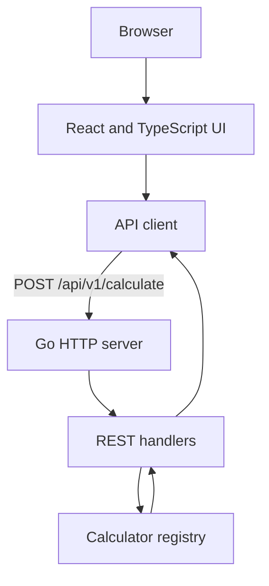

# Calculator

A full stack calculator with a React and TypeScript frontend and a Go REST
backend. The browser sends every operation to the backend, which validates the
request and returns a JSON response.

## Features

The application supports:

* Addition
* Subtraction
* Multiplication
* Division
* Exponentiation
* Square root
* Percentage

The interface is centered, responsive, and usable on small screens. Input is
entered through the on-screen keypad; physical keyboard input is not supported.
Backend failures and invalid input are shown as readable messages instead of
raw network errors.

## Requirements

* Go 1.23 or newer
* Node.js 20 or newer
* npm 10 or pnpm 9 or newer
* GNU Make is optional

Docker is optional and is not required for local development.

## Run with Docker

Docker Desktop must be running before using this option:

```bash
docker compose up --build
```

Open `http://localhost:8080`. The Go server serves the compiled React
application and the REST API from the same origin. Stop the container with:

```bash
docker compose down
```

## Run without Docker

### Backend

```bash
cd backend
go run ./cmd/server
```

The server listens on `http://localhost:8080`. Set `PORT` to use another port.

### Frontend with npm

In another terminal:

```bash
cd frontend
npm install
npm run dev
```

Open `http://localhost:5173`. Vite proxies `/api` requests to the backend.

### Frontend with pnpm

The project keeps both `package-lock.json` and `pnpm-lock.yaml`, so contributors
can choose either package manager:

```bash
cd frontend
pnpm install
pnpm run dev
```

pnpm may block dependency build scripts on the first install. Approve only the
required `esbuild` package with `pnpm approve-builds`.

All frontend scripts are equivalent in npm and pnpm:

```bash
npm run test
pnpm run test
```

Do not run npm and pnpm installs at the same time in the same directory.

## Make commands

The Makefile uses npm by default. Set `PACKAGE_MANAGER=pnpm` to use pnpm for
frontend commands.

```bash
make build
make test
make lint
make coverage
make run-backend
make run-frontend
make PACKAGE_MANAGER=pnpm test-frontend
```

The equivalent direct commands are useful on Windows when GNU Make is not
installed.

## Project structure

```text
backend/
  cmd/server/                 Server entry point
  internal/api/               HTTP handlers, routes, and response contracts
  internal/calculator/        Pure calculator operations and registry
frontend/
  src/api/                    Backend client
  src/components/             React interface
  src/test/                   Test setup
Makefile                     Development shortcuts
```

The calculator domain does not know about HTTP. The API layer translates JSON
requests and domain errors into HTTP responses. The frontend API client is the
only frontend module that knows the REST contract.

## Architecture



During local development, Vite serves the frontend and proxies `/api` to the
Go process. This keeps the browser on one origin while the two services remain
independently testable.

## API

### Calculate

```http
POST /api/v1/calculate
Content-Type: application/json
```

Request:

```json
{
  "operation": "add",
  "operands": [2, 3]
}
```

Response:

```json
{
  "result": 5
}
```

Examples:

```bash
curl -X POST http://localhost:8080/api/v1/calculate \
  -H "Content-Type: application/json" \
  -d '{"operation":"add","operands":[2,3]}'

curl -X POST http://localhost:8080/api/v1/calculate \
  -H "Content-Type: application/json" \
  -d '{"operation":"subtract","operands":[10,4]}'

curl -X POST http://localhost:8080/api/v1/calculate \
  -H "Content-Type: application/json" \
  -d '{"operation":"multiply","operands":[6,7]}'

curl -X POST http://localhost:8080/api/v1/calculate \
  -H "Content-Type: application/json" \
  -d '{"operation":"divide","operands":[10,4]}'

curl -X POST http://localhost:8080/api/v1/calculate \
  -H "Content-Type: application/json" \
  -d '{"operation":"power","operands":[2,10]}'

curl -X POST http://localhost:8080/api/v1/calculate \
  -H "Content-Type: application/json" \
  -d '{"operation":"sqrt","operands":[16]}'

curl -X POST http://localhost:8080/api/v1/calculate \
  -H "Content-Type: application/json" \
  -d '{"operation":"percentage","operands":[20,50]}'
```

### Other endpoints

* `GET /api/v1/operations` lists supported operations and their arity.
* `GET /healthz` returns `{"status":"ok"}`.

`GET /api/v1/operations` returns:

```json
{
  "operations": [
    { "name": "add", "arity": { "min": 2, "max": 2 } },
    { "name": "sqrt", "arity": { "min": 1, "max": 1 } }
  ]
}
```

Errors use this shape:

```json
{
  "error": {
    "code": "DIVISION_BY_ZERO",
    "message": "division by zero"
  }
}
```

The API rejects malformed JSON, unknown fields, missing operations, invalid
operand counts, null operands, unsupported content types, and oversized
requests. Division by zero and invalid mathematical domains return HTTP 422.

| Code | Status | Meaning |
| --- | ---: | --- |
| `INVALID_JSON` | 400 | The request body is not valid JSON |
| `UNKNOWN_FIELD` | 400 | The body contains an unsupported field |
| `MISSING_FIELD` | 400 | The operation is missing or empty |
| `UNKNOWN_OPERATION` | 400 | The operation is not supported |
| `INVALID_OPERAND_COUNT` | 400 | The operation received the wrong number of operands |
| `UNSUPPORTED_MEDIA_TYPE` | 415 | The content type is not JSON |
| `REQUEST_TOO_LARGE` | 413 | The request body exceeds the size limit |
| `DIVISION_BY_ZERO` | 422 | The divisor is zero |
| `MATH_DOMAIN_ERROR` | 422 | The operation is undefined for the operands |
| `RESULT_OUT_OF_RANGE` | 422 | The result cannot be represented in the supported numeric range |

## Testing and coverage

Backend:

```bash
cd backend
go test ./...
go vet ./...
go test ./... -cover
```

Frontend:

```bash
cd frontend
pnpm test
pnpm typecheck
pnpm lint
pnpm test:coverage
pnpm build
```

Replace `pnpm` with `npm run` when using npm. Generated coverage and build
artifacts are ignored by Git.

The latest command output is kept in:

* [Backend coverage](coverage-report/backend.txt)
* [Frontend coverage](coverage-report/frontend.txt)

Current snapshot:

* Backend: 84.3% in the API package and 97.9% in the calculator package,
  91.1% simple average across the two tested internal packages.
* Frontend: 78.21% statements, 66.03% branches, and 68.75% functions.

The reports are snapshots of the local test commands and can be regenerated
when the implementation changes.

## Design decisions and assumptions

* The backend uses a small operation registry. Each operation is a pure
  strategy with an explicit arity, so adding an operation does not require
  changing the HTTP handler.
* Mathematical rules live in the calculator package, while HTTP parsing,
  status codes, and JSON responses live in the API package. This keeps the
  domain logic independently testable.
* The frontend uses a small API client instead of performing calculations in
  the browser. The backend is the source of truth for validation and results.
* The API uses one calculation endpoint with operation names and an operand
  array. This keeps the contract consistent across basic and advanced
  operations.
* Errors use stable machine readable codes and human readable messages. The
  frontend can show a useful message without depending on a particular HTTP
  status text.
* The interface uses semantic buttons, visible focus styles, labels, live
  result announcements, and a responsive grid. The layout does not depend on
  absolute positioning or a particular screen size.
* The backend can serve the built frontend from the same process. This keeps
  the Docker deployment small and avoids a separate production web server for
  this application.
* Percentage means `first * second / 100`. Square root accepts one operand.
  Exponentiation and all basic operations accept two operands.
* Results are rounded only for display in the frontend. The API returns the
  calculated number without applying presentation formatting.
* Very large or very small finite results are displayed in scientific notation
  in the frontend. For example, `100 ^ 100` is shown as approximately
  `1e+200`; this is a display choice, not an error.

## Known limitations

* The frontend requires the backend to be running for calculations. It shows a
  message in the display when the API cannot be reached, but it does not queue
  requests for later.
* The interface currently supports one pending binary operation at a time. It
  is not intended to parse complete mathematical expressions with precedence
  and parentheses.
* The calculator sends one request for each completed operation. It does not
  provide an offline mode or calculate locally when the service is unavailable.
* Results and expressions are intentionally compact. Very long values may be
  shortened visually on narrow screens.
* JavaScript, JSON, and the Go API use floating point numbers, so extremely
  large results can be approximate even when they are mathematically finite.
  Values beyond the supported floating point range are rejected by the backend
  with `RESULT_OUT_OF_RANGE`. This means the value cannot be represented by
  this service, not that the mathematical result is undefined.
* The Docker image uses npm during its frontend build, while local development
  supports both npm and pnpm.

## Git workflow

Feature work is pushed to a feature branch and integrated into `main` through a
pull request. Commits use English messages with Gitmoji prefix.

GitHub Copilot was used as an assistant for mechanical implementation tasks.
The prompts used during development are documented in [AI_PROMPTS.md](AI_PROMPTS.md).
